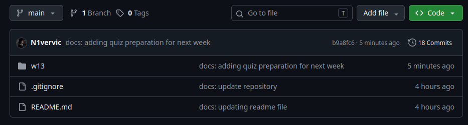
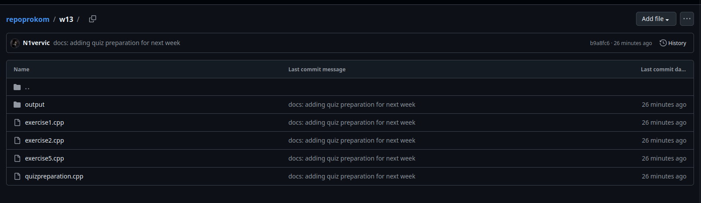
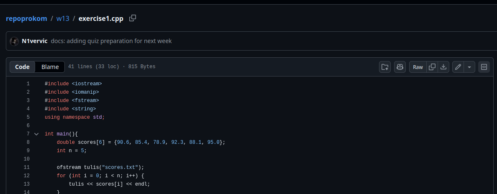

# Pemrogaman Komputer

Dalam repository, terdapat beberapa folder sesuai materi di minggu itu

  

##
Dalam folder terdapat materi yang dibutuhkan (latihan, persiapan kuis, persiapan ets, dan lain lain). File txt dapat dilihat di folder output

  

##
Tekan tombol download untuk mengunduh file cpp sesuai keperluan

    

